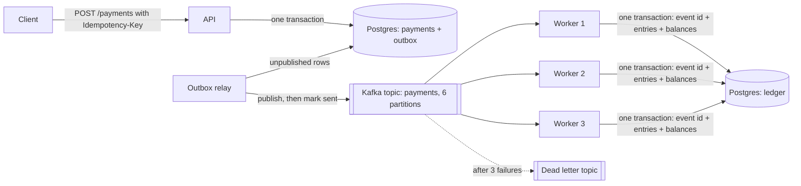

# Settle

[](https://github.com/manaswichowdary/settle/actions/workflows/ci.yml)

An event driven payments ledger in Java and Spring Boot, with Kafka and PostgreSQL. A payment is accepted once, published once, and applied to account balances exactly once, even when the services crash in the middle.

## The problem

Moving money across services fails in quiet ways. A client times out and retries, so the payment is charged twice. A service saves a payment and crashes before telling anyone, so it is lost. A worker applies a payment and dies before recording that it did, so it is applied again. Each of these needs only one crash at the wrong moment.

## The result

<!-- RESULTS:START -->
A crash test sent 20,000 payments from 32 threads while killing a worker every 4 seconds and the API twice. It ran on one laptop (MacBook Air, everything in Docker, 1 API and 3 workers).

| What was checked | Result |
|---|---|
| Payments accepted | 20,000 of 20,000 (0 failed requests) |
| Payments lost | 0 |
| Payments applied more than once | 0 |
| Ledger sum and balance mismatches | 0 and 0 |
| Worker kills, API kills | 12, 2 |
| Client retries after a dead connection | 2,115 |
| Requests replayed with the same key | 995 (each saved once) |
| Duplicate Kafka deliveries skipped by the ledger | 15 |
| Send speed | 230 payments per second |
| Time from saved to applied in the ledger (median, 95th percentile) | 16.3 s, 47.5 s |

The ledger falls behind while workers are being killed (up to 8,520 messages behind), which is why the apply times are long. Nothing was lost during that. Details are in `results/crash_test.json`.
<!-- RESULTS:END -->

## One hard decision

Kafka cannot give "exactly once" across a database and a message broker on its own, so I did not try to. Delivery is at least once on purpose, and every step that could repeat is made safe to repeat:

- **Client retries.** Every request carries an idempotency key. A retried key returns the first payment; the same key with a different body is rejected with 409.
- **Saving and publishing.** The payment and its event are written in the same database transaction (the outbox). A separate relay publishes outbox rows to Kafka and marks them sent only after Kafka confirms. A crash in between means the event is sent again, never lost.
- **Applying.** A worker records the event id and writes the ledger entries in one transaction, and Kafka moves on only after that commits. A repeated event finds its id already recorded and is skipped.

The cost is extra writes per payment and duplicates on the wire. The crash test counts how many duplicates were skipped, so the protection is shown working, not assumed.

## How the parts fit together



Other details that matter:

- **Double entry.** Each payment is a debit and a credit that sum to zero, so the whole ledger must always sum to zero.
- **No deadlocks.** Two workers updating the same two accounts in opposite order could wait on each other forever, so balances are always locked in account order.
- **Bad messages do not block.** An event that keeps failing is retried 3 times, then moved to a dead letter topic. Invalid JSON goes there straight away.
- **Several relays can run.** The relay reads rows with `for update skip locked`, so two copies never send the same row at the same time.
- **One codebase, two roles.** The same image runs as the API (with the relay) or as a worker, chosen by environment variables.

## Run it

Needs Docker. Tests also need Java 21 or newer and Maven.

```bash
make up        # Postgres, Kafka, the API and 3 workers
make crash     # 20,000 payments while killing workers and the API (N=50000 make crash for more)
make check     # the ledger checks as JSON
make test      # unit tests and the full flow against real Postgres and Kafka (Testcontainers)
make down
```

```bash
curl -X POST localhost:8080/payments \
  -H 'Content-Type: application/json' -H 'Idempotency-Key: 6f1c2d3e-0001' \
  -d '{"fromAccount":"acct-001","toAccount":"acct-002","amountCents":500,"currency":"USD"}'
```

## What the crash test does

`scripts/crash_test.py` sends payments from 32 threads to 100 accounts. While they are being sent, it kills a random worker with SIGKILL every 4 seconds (and starts it again), and kills the API twice. Clients that lose a request retry with the same key, and 5% of clients send every request twice on purpose. Afterwards it waits for the ledger to catch up and checks:

- every accepted payment has exactly two ledger entries (none lost, none applied twice)
- the ledger sums to zero and every balance equals its entries
- the outbox is empty, and the number of new payments equals the number of successful requests

## Known limits

- One Postgres holds both the API tables and the ledger. In a larger system each service would own its database.
- One Kafka broker, so this tests crashes of the services, not of Kafka itself.
- Balances may go negative. There is no overdraft rule, which would need events for the same account to be processed in order.
- The numbers come from one laptop running everything in Docker. One run, not an average of several.
- Apply latency under load and crashes is high (median 16 s). A single payment on an idle system took 0.37 s to reach the ledger. I did not measure latency under load without crashes.

## What I would do next

- Partition events by account so an overdraft rule can be enforced in order.
- Run three Kafka brokers and kill one during the test.
- Add tracing to follow one payment from the API to the ledger.
- Replace the polling relay with change data capture (Debezium).
